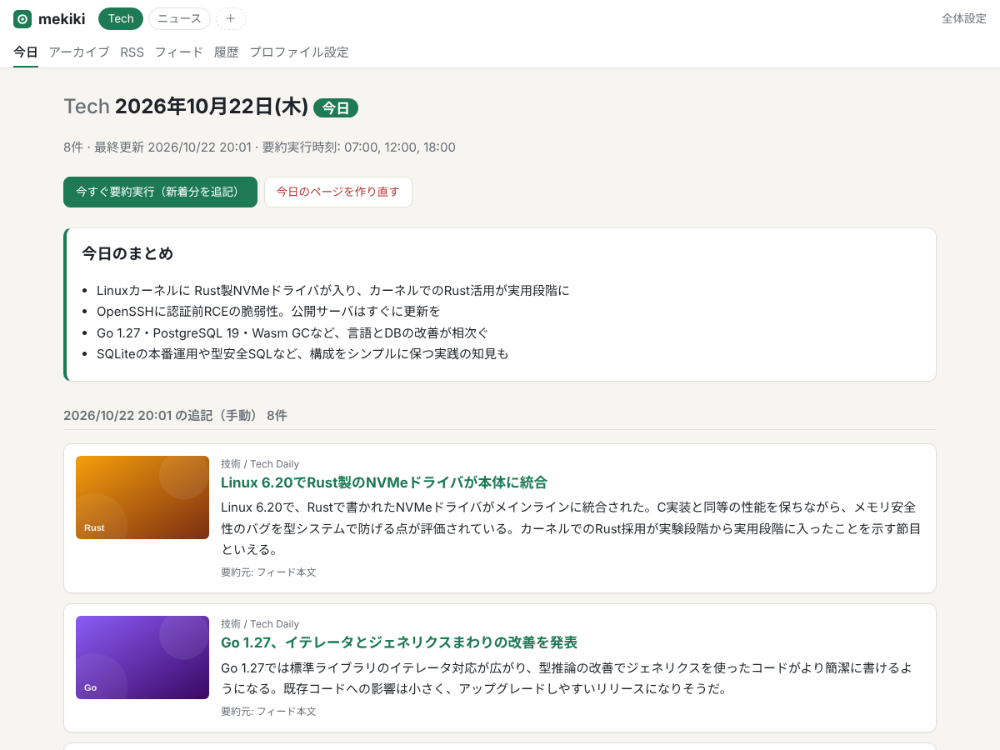
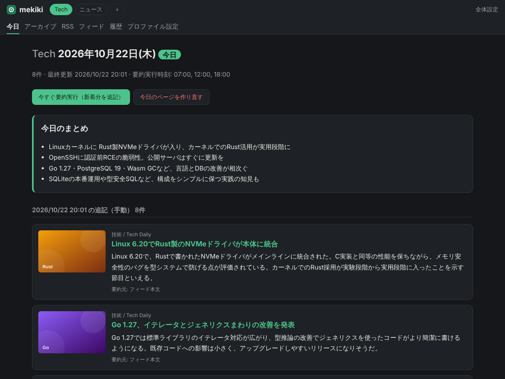
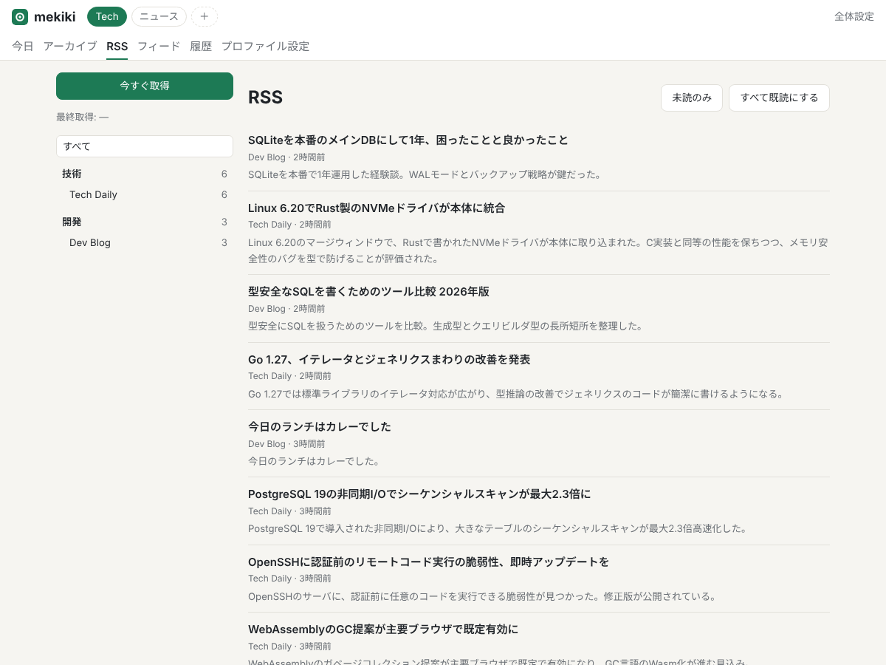
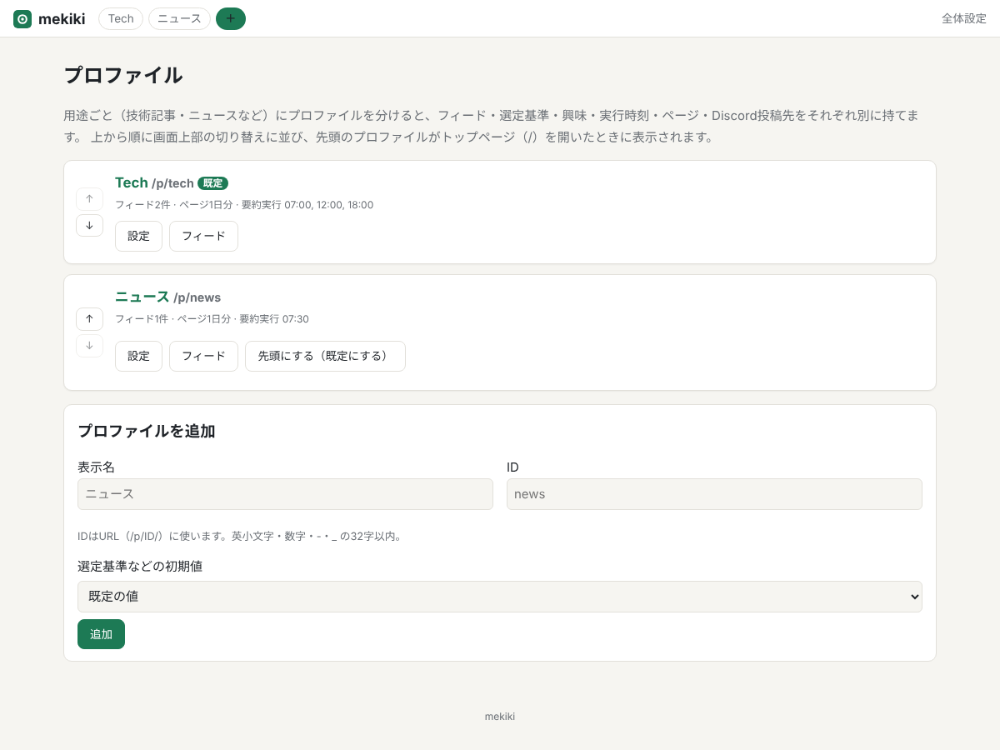
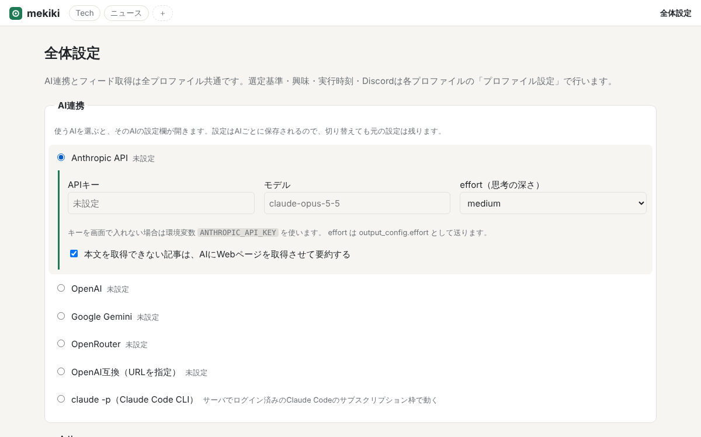
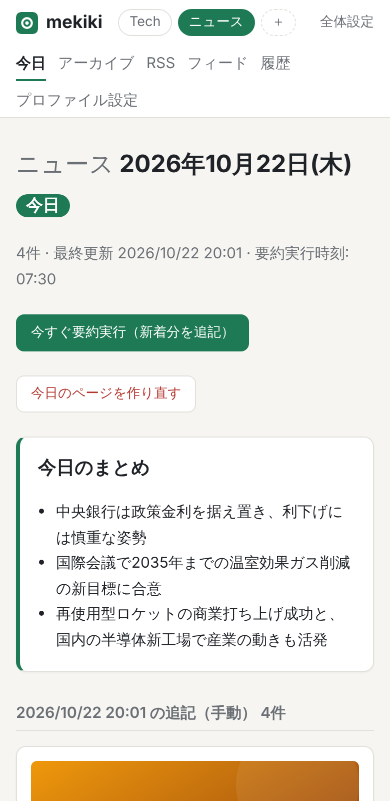

#  mekiki

RSS/Atomフィードを集め、AIが注目記事を選んで日本語で要約した「今日のページ」を作るWebアプリ。
サーバで常駐させ、ブラウザから見る。

- **今日のページ（メイン）**: 設定した時刻（1日に複数回でもよい）に、前回の実行以降に増えた記事からAIが
  注目記事を選び、要約して今日のページに追記する。日付ごとにページが保存され、アーカイブ（カレンダーと月ごとの一覧）から過去の日を辿れる。
  ページの先頭にはその日の「今日のまとめ」も付く。ボタンで手動実行・今日のページの作り直しもできる
- **プロファイル**: 「Tech」「ニュース」のように用途ごとにプロファイルを作り、画面上部で切り替える。
  フィード・選定基準・興味・実行時刻・ページ・Discord投稿先はプロファイルごとに別
- **RSSリーダー（サブ）**: 取得した記事をフィード・カテゴリ別に一覧できる。取得は定期実行＋「今すぐ取得」ボタン
- **AI連携**: 次から選べる（全プロファイル共通）
  - Anthropic API（デフォルト）
  - OpenAI / Google Gemini / OpenRouter
  - OpenAI互換API（URLを指定。Ollama・LM Studio・vLLMなどのローカルLLMも可）
- **Discord投稿（任意）**: プロファイルにWebhook URLを設定すると、追加された記事をDiscordにも投稿する
- 設定・フィード管理はすべてWeb画面で行う。単一の静的リンクバイナリで、データはSQLiteファイル1つ

## スクリーンショット

（記事・フィードはすべて架空のデモデータ）

**今日のページ** — AIが選んだ記事の要約と「今日のまとめ」。ダークモードにも対応

 

**RSSリーダー** と **プロファイル**

 

**AI連携の設定** と **スマホ表示**

 

## セットアップ

### 1. 入手・ビルド

[Releases](https://github.com/kienn-HCl/mekiki/releases) から、使うOS・CPU向けのアーカイブ
（linux / darwin の amd64・arm64、windows amd64）をダウンロードして展開する。中身はバイナリ1つと README・LICENSE・THIRD_PARTY_LICENSES.txt、`deploy/`（systemdユニット・環境変数・OPMLの例）。

自分でビルドする場合は Go 1.26以上:

```sh
make          # → ./mekiki（make を使わないなら CGO_ENABLED=0 go build -o mekiki ./cmd/mekiki）
```

またはNix:

```sh
nix build                 # → result/bin/mekiki（テストも実行される）
```

### 2. 起動

```sh
MEKIKI_PASSWORD=好きなパスワード ./mekiki serve -addr :8080 -data ./data
```

`http://サーバ:8080/` を開き、ユーザー名 `mekiki`（`MEKIKI_USER` で変更可）・パスワード `MEKIKI_PASSWORD` でログインする。

| 環境変数 / フラグ | 内容 |
|---|---|
| `-addr` / `MEKIKI_ADDR` | 待ち受けアドレス（既定 `:8080`） |
| `-data` / `MEKIKI_DATA` | データディレクトリ（既定 `./data`）。`mekiki.db` が作られる |
| `MEKIKI_PASSWORD` | 設定するとBasic認証をかける。**外部に公開するなら必ず設定する** |
| `MEKIKI_USER` | Basic認証のユーザー名（既定 `mekiki`） |
| `ANTHROPIC_API_KEY` / `OPENAI_API_KEY` / `GEMINI_API_KEY` / `OPENROUTER_API_KEY` / `OPENAI_COMPAT_API_KEY` | 画面でAPIキーを入れない場合に使うキー |

Basic認証は通信を暗号化しないので、インターネット越しに使う場合はHTTPS化したリバースプロキシ
（Caddy・nginxなど）の内側に置く。

### 3. 画面での初期設定

初回起動時は「メイン」プロファイルが1つだけある。

1. **全体設定**（右上）— AI連携を選ぶ。「AI接続テスト」ボタンで疎通を確認できる
   - Anthropic API: APIキーを入力（または環境変数 `ANTHROPIC_API_KEY`）。モデルの既定は `claude-opus-5-5`
   - OpenAI / Gemini / OpenRouter: APIキーとモデル名を入力（OpenRouterのモデル名は `openai/gpt-5.1` の形式）
   - OpenAI互換: APIのURL（例 Ollamaなら `http://localhost:11434/v1`）とモデル名。キーが不要なら空のまま
2. **プロファイル**（上部の「＋」）— 必要ならプロファイルを追加する。表示名とID（URLに使う。例 `tech`）を決める。
   既存プロファイルの選定基準などをコピーして作ることもできる。一覧で並べ替えができ、先頭のプロファイルが
   トップページを開いたときに表示される
3. **フィード** — プロファイルごとにフィードURLを追加するか、OPMLをインポートする（形式は `deploy/example.opml`）
4. **プロファイル設定** — 興味・趣向、選定基準、要約実行の時刻（例 `07:00, 12:00, 18:00`）、Discordの投稿先を入れる
5. **今日** — 「今すぐ要約実行」を押すと最初のページができる

AI連携が未設定のうちは、定時の要約実行は保留される（設定が済むと、その日の直近の枠が実行される）。

## 設定ファイルとバックアップ

設定はデータディレクトリ（`-config` / `MEKIKI_CONFIG` で別の場所にもできる）のテキストファイルに保存される。

| ファイル | 内容 |
|---|---|
| `config.toml` | 全体設定（AI連携・フィード取得）とプロファイル（選定基準・興味・実行時刻・Discord） |
| `feeds/<プロファイルID>.opml` | プロファイルごとのフィード一覧（無効にしたフィードは `disabled="true"`） |
| `mekiki.db` | 記事・日付ページ・実行履歴・フィードの取得状態（SQLite。アプリが自動で作るデータ） |

- Web画面で保存すると config.toml / OPML が書き換わる
- サーバ上でテキストエディタで編集したら、mekikiを再起動すると反映される。
  書き間違いがあればエラー（行番号・項目名）を出して起動しない
- 編集してから再起動するまでの間は、編集内容を上書きしないよう、画面からの設定変更は止まる
- 初回起動時に config.toml がなければ、既定の設定（プロファイル「メイン」1つ）で作られる
- config.toml からプロファイルを消すと、そのページ・履歴も削除される（削除前のDBは `backups/` に退避される）
- 全体設定の「設定ファイルとバックアップ」から、設定一式（config.toml + OPML）のzipダウンロード
  （APIキー・Webhookを除いた版も可）、zip または config.toml からの復元、データ全体（mekiki.db）のダウンロードができる

## 動き方

- **フィード取得**: 設定した間隔（既定60分）で全フィードを取得する。要約実行の直前にも取得する
- **要約実行（追記）**: 前回の実行で選定に渡していない新着記事だけを候補にし、今日のページに追記する。
  今日すでに載っている記事のタイトルも渡し、同じ話題を選ばないようにしている。新着がなければ何もしない
- **今日のページを作り直す**: 今日のページを消し、今日の候補記事すべてからページを作り直す
  （選定・要約が成功してから置き換えるので、失敗しても元のページは残る）
- 選定に失敗した実行は記事を消費しない（次回の実行で再び候補になる）
- 実行の結果とAIの使用量（トークン数）は「履歴」画面と各日のページ下部で確認できる
- 要約実行は同時に1つ。複数のプロファイルの実行時刻が重なった場合は順番に実行される
- 本文が取れない記事をAIにWebページを取得させて要約する救済は、Anthropic API だけが対応する
  （他の経路ではタイトルから読み取れる範囲の要約になる）

## コマンド

```sh
mekiki serve                                     # Webサーバ＋スケジューラ
mekiki import-opml [-profile ID] FILE            # OPMLからフィードを登録
mekiki import-opml -profile news -new ニュース FILE # プロファイルを作ってから登録
mekiki fetch                                     # 全フィードを1回取得
mekiki digest [-profile ID] [-rebuild]           # 要約実行を1回（サーバ停止中のメンテナンス用）
```

`-profile` を省略すると最初のプロファイルが対象。いずれも `-data` でデータディレクトリを指定する。`fetch` / `digest` はサーバとは別プロセスで動くため、
サーバ稼働中はWeb画面のボタンを使う。

## systemdで常駐させる

`deploy/mekiki.service` を参考に:

```sh
sudo useradd -r -m -d /var/lib/mekiki -s /usr/sbin/nologin mekiki
sudo cp mekiki /usr/local/bin/
sudo cp deploy/mekiki.service /etc/systemd/system/
sudo systemctl edit mekiki      # MEKIKI_PASSWORD などを設定
sudo systemctl enable --now mekiki
```

## 開発

リリース: `v1.2.3` のようなタグをpushすると、GitHub Actions（`.github/workflows/release.yml`）がテストを通してから
各OS向けのバイナリをビルドし、Releaseに添付する（`SHA256SUMS` 付き）。ビルド手順は `Makefile` にあり、
Actionsが呼ぶのと同じ `make dist` で手元でも全OS向けのアーカイブを `dist/` に作れる
（`make dist TARGETS=linux/amd64` で一部だけ）。

```sh
nix develop      # go・gopls・claude-code
go test ./...
go run ./cmd/mekiki serve -data ./data
```

## ドキュメント

[docs/SPEC.md](docs/SPEC.md) — 仕様書。設計判断の経緯・運用で踏んだ障害の記録は付録A。

## ライセンス

[MIT](LICENSE)。リリースのアーカイブには、バイナリに組み込まれる依存ライブラリとGoのライセンス文を
`THIRD_PARTY_LICENSES.txt` として同梱している（`scripts/third-party-licenses.sh` で生成）。
